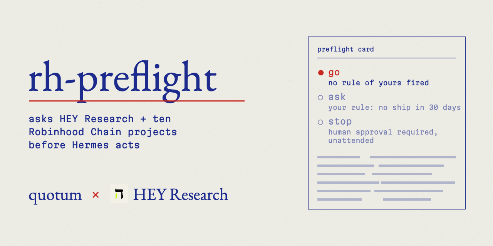

# rh-preflight

rh-preflight by [quotum](https://quotum.org) with [HEY Research Lab](https://heyresearch.xyz).



[](https://github.com/quotumorg/rh-preflight/actions/workflows/tests.yml)

rh-preflight reads public project records and applies your approval rules before Hermes acts on Robinhood Chain.

HEY Research Lab, co-author, supplies the builder record with links to what HEY read; rh-preflight makes the go / ask / stop decision under your rules; ten other Robinhood Chain projects each add a line where they apply. Applicable reads run concurrently under one deadline; the coverage line shows who answered, did not apply or stayed silent. OffRouter joins for its own project; RPC, DexScreener and GeckoTerminal are separate infrastructure reads. The [source table](docs/SOURCES.md#chosen-sources-hey-research-lab-plus-ten-robinhood-chain-projects) and [bundled captures](tests/fixtures/captures/README.md) document that scope.

The plugin runs at the pre-tool hook, requests a human answer when your rules require it, and records each check in a local ledger. A prompt or skill alone cannot enforce that gate. Source records describe what each project published; you decide what to do.

Not this: rh-preflight is not a safety oracle and does not call a token good or bad. It never signs, pays, revokes or sends a transaction, and holds no keys.

### Security and footprint

- Sends: the addresses, agent ids, project names or repository names you act on, to the source hosts in [Sources](#sources), plus read-only RPC, DexScreener and GeckoTerminal reads. Nothing else from tool arguments.
- Stores: one local SQLite ledger of checks in the active profile's `plugin-data/rh-preflight/` directory. No credentials.
- Runs: bounded HTTP reads inside the hook's deadline. No subprocess, background service, signature, payment or external write.
- Installs: the Python core uses the standard library; nothing extra is downloaded.
- After `hermes plugins remove rh-preflight`: the plugin directory is deleted; the ledger stays in `plugin-data/rh-preflight/` until you delete it.

Reproducible PRIORS output from `python3 demo/offline.py`, using the bundled 2026-11-09 captures:

```text
if Hermes swapped this now: go · no rule of yours fired
11 sources · 8 answered · 1 not for this target: Borro · off: Sherwood, OffRouter
HEY Research Lab: Priors Agents · 0xedbf91223639800bcd5756815caf908df3b890be · https://heyresearch.xyz/project/priors-agents
priors-agents: SHIPPING under HEY's activity rule (hbm-v35). SHIPPING by the activity rule: 6 counted ships in the last 30 days, the newest 2026-11-09. This is a record of development, not a view on the token.
Verified Builder: not in HEY's answer
Latest meaningful ship: title not in HEY's answer · 2026-11-09T09:53:07.000Z · https://heyresearch.xyz/api/evidence/ship%3A759f85a9-93ce-4666-8d19-8a9b73035be1
Freshness: live at 2026-11-09T10:45:07.534Z; recent at 2026-11-09T10:11:36.953Z · asOf: 2026-11-09T10:46:45.421Z
Priors: agent #7622 Minimum Viable Agent: 4 loans repaid, 40 USDG repaid, defaulted: no, frozen: no · https://priors.trade/agent?id=7622
Sentinelhood: ERC-20 PRIORS, launched on pons by 0x9f05…ac0f, 6 launches by that deployer, block 110264821 · https://sentinelhood.com/?ca=0xedbf91223639800bcd5756815caf908df3b890be
HoodLock holds no token lock or vesting for this token (token locks and vesting only; LP locks in HoodLock's Liquidity Locker and other lockers not read) · https://hoodlock.tech/lock-checker
Trnch: no rug, no dump on record · first seen 2026-10-14T11:50:25.981Z · https://trnch.fun/token/0xedbf91223639800bcd5756815caf908df3b890be
Agent Wormhole has not observed this token; that is not a verdict · https://dashboard.agentwormhole.com/t/4663/0xedbf91223639800bcd5756815caf908df3b890be
Hookr's page no longer lists hooks in a readable form · https://hookr.fun/hooks
Toll: card loads; MCP did not answer; x402 answered HTTP 402. payTo matches registered agentWallet · https://t0ll.xyz/agents/census?agent=7622
DexScreener: uniswap v4 pair, liquidity $1,076,142.88, 24h volume $90,340.22, pair since 2026-09-19 · https://dexscreener.com/robinhood/0xff7b3bd2db34d9ed8160e6dedf1d448777abaa1fa6fc8a31144930a1a656fd92
GeckoTerminal: FDV $9,817,064.86, CoinGecko listing priors-agent · https://www.geckoterminal.com/robinhood/tokens/0xedbf91223639800bcd5756815caf908df3b890be
Source: HEY Research Lab, builder research for Robinhood Chain, https://heyresearch.xyz/project/priors-agents, as of 2026-11-09, rules hbm-v35
```

Reproducible NVDA output from the same command:

```text
if Hermes swapped this now: ask · your rule: HEY record could not be read
11 sources · 2 answered · 1 not for this target: HEY · off: Priors, Sentinelhood, HoodLock, Trnch, Agent Wormhole, Hookr, Sherwood, OffRouter
NVDA · 0xd0601ce157db5bdc3162bbac2a2c8af5320d9eec
HEY response for NVDA was not captured; no builder reading shown
Toll: official Robinhood Stock Token NVDA, ISIN US67066G1040, status ASSET_STATUS_ACTIVE, registry as of 2026-11-09T17:54:06.940Z; chain price $176.80 read 2026-11-09T18:08:17.266Z; Chainlink reference $177.56 updated 2026-11-09T17:06:17.000Z · https://t0ll.xyz/markets/NVDA
Borro: NVDA lending market present, lending fees 0.000300%/year before BORRO drip, short borrow fees 0.026200%/year, Borro short desk price $176.77 vs feed $176.59 at 2026-11-09T18:22:24Z · https://borro.markets
```

## Quickstart

Requires Hermes **0.23.0 or later**, with 0.23.0 checked locally. Allow roughly 3-5 minutes with Hermes already configured, plus 2-3 minutes for the approval walkthrough. These are setup estimates.

```sh
hermes plugins install quotumorg/rh-preflight --no-enable
hermes plugins enable rh-preflight
hermes plugins list
```

For a local checkout, run `hermes plugins install "file://$(pwd)" --no-enable` from the clone root; only committed files are cloned. Then enable and list the plugin as above.

Confirm `rh-preflight` is enabled in the active profile. Exit Hermes and start it again:

```sh
hermes
```

In that session:

```text
/rh-preflight 0xd0601ce157db5bdc3162bbac2a2c8af5320d9eec
```

This reads a card only. It evaluates a hypothetical attended swap, does not open an approval prompt, and does not add a check to history. The bundled NVDA replay shows `ask · your rule: HEY record could not be read`: its HEY response was not captured. Official Stock Tokens confirmed by Toll are exempt from the no-HEY-record rule by default, but an unread builder record still requests approval. Both opening cards replay bundled captures; they do not establish today's source responses.

| Card label | Meaning |
| :--- | :--- |
| `go` | The plugin permits the detected call under your settings. Other Hermes checks still apply. |
| `ask` | Your rules require a human answer before the detected call. A read-only card only previews this. |
| `stop` | The detected call is blocked because a person cannot answer, or the local check failed. |
| `note` | The card is appended without an approval gate, even if rules fire. |

Coverage partitions 11 sources: HEY Research Lab plus ten Robinhood Chain projects. `answered` includes no-record replies; `not for this target` means unmatched or inapplicable; `silent` shows each additional source's structured reason (`unreachable`, `refused`, `rate limited` or `payment required`) with seconds waited, for example `silent: Toll (payment required; 0.1 s)`. HEY keeps its seconds-only label because its structured failure reason is not retained. `off` means disabled. **A go card can contain silent sources** when no enabled rule depends on them. [Coverage details](docs/SOURCES.md#coverage) explain the count.

### See an approval prompt

In your terminal, set the plugin to ask on every detected action:

```sh
hermes config set plugins.entries.rh-preflight.settings.mode ask
```

Start an interactive `hermes` session with approvals enabled and yolo disabled. Ask Hermes to run this literal read-only command through its terminal tool:

```sh
cast call 0xd0601ce157db5bdc3162bbac2a2c8af5320d9eec 'symbol()(string)' --rpc-url https://rpc.mainnet.chain.robinhood.com
```

The plugin detects literal `cast call` commands as well as writes. Its card should begin `ask · your rule: ask before every detected action`; Hermes presents the human approval choices. Choose **deny**. The command is blocked before execution, so this walkthrough does not require a wallet or an installed `cast`. If the agent only explains the command, request a terminal tool call. A slash-card read cannot demonstrate this prompt.

Then run `hermes rh-preflight log` in your terminal to see the recorded check and human response, and restore the default mode:

```sh
hermes config set plugins.entries.rh-preflight.settings.mode ask_when
```

If you see `stop`, use an attended session with approvals enabled; leave `allow_unattended` false. If `/rh-preflight` is missing, check the enabled plugin in the same profile and restart. This walkthrough uses public reads. For a provider-free offline demonstration of the directive, denial and ledger, run `python3 demo/gate_replay.py` from the clone; it simulates host events and does not show a host prompt.

Desktop keeps the answer, coverage and complete `target:` identifier visible and puts source details in a native disclosure. The answer is colored by outcome (go, ask, stop, note), an eleven-segment bar under the coverage line shows each source's bucket, and a source list names every project with its bucket, silent reason and a link to the source page it answered with. Colors come from the stored answer and coverage line; links come from each source's own answer as recorded in the local ledger. Desktop loads no logos or other remote assets. `hermes rh-preflight card` colors the outcome word on a terminal and prints plain text when output is redirected or `NO_COLOR` is set. Multi-target rows show the count, for example `swap · 2 checked targets`. Repository URLs, agent ids and pool ids use the same target label without guessing a role or chain. Human responses distinguish checks that did not request approval, unanswered requests, denials, timeouts, cancellations and the three recorded approval choices. Approvals say that execution is not recorded. Legacy rows still render.

Enable the optional Desktop half for the active profile to see checks in the sidebar and the status chip. The Python core uses the standard library. The dashboard uses the host's FastAPI adapter and Desktop uses the host's React runtime. The MIT license covers this plugin.

## See the gate without a model

From the cloned repository directory, run the explicit `deny-retry-unattended` scenario with no sockets, model or provider. The host events are simulated, source lines use bundled captures, and the ledger is temporary. Uncaptured sources are off. Clocks use fixture time; real approval keys remain unique and are shown as display aliases. The default `python3 demo/offline.py` demo is unchanged.

```sh
python3 demo/gate_replay.py
```

```text
simulated · offline gate replay · deny-retry-unattended · clock: 2026-11-09T10:46:47.178Z
simulated · rh-preflight by quotum with HEY Research Lab · https://heyresearch.xyz
simulated · bundled captures; uncaptured sources off; temporary ledger; no Hermes prompt
simulated · swap · chain 4663 · 0x000000000000000000000000000000000000dead
simulated · ask · your rule: no HEY record
simulated · 11 sources · 2 answered · off: Priors, HoodLock, Trnch, Agent Wormhole, Hookr, Toll, Borro, Sherwood, OffRouter
simulated · HEY Research Lab: no published project for this contract (HEY's index, not a statement about the token) · asOf: 2026-11-09T10:46:47.178Z · https://heyresearch.xyz
simulated · Sentinelhood: no contract at this address, block 110264826 · https://sentinelhood.com/?ca=0x000000000000000000000000000000000000dead
simulated · hook directive: approve (ask) · approval key: request-1 (display alias)
simulated · host event via post_approval_response · human response: deny
simulated · ledger request-1 · disposition: ask · human response: denied
simulated · retry: fresh approval required · approval key: request-2 (display alias)
simulated · ledger request-2 · disposition: ask · human response: not recorded
simulated · unattended · hook directive: block · stop · human approval required, unattended
simulated · action executions: 0
```

For a labelled simulated swap combining the bundled PRIORS HEY projection and missing-target capture, run `python3 demo/gate_replay.py --scenario two-target-deny-retry-unattended`. It names only the missing target behind the rule, denies the whole call through the observer, retries with a fresh key and stops unattended. No uncaptured badge follow-up is made.

## Settings

Settings live under `plugins.entries.rh-preflight.settings`. Policy and source toggles are read for every check. Restart Hermes after changing the timeout. `sources` is a mapping from `priors`, `sherwood`, `hookr`, `wormhole`, `toll`, `dexscreener`, `geckoterminal`, `chain`, `offrouter`, `sentinelhood`, `hoodlock`, `trnch` and `borro` to `on` or `off`. All entries default to `on`. The core builder source stays enabled.

For example, merge these keys into the active profile's `config.yaml`. Keep `ask_no_record` at the settings level and `stock_no_hey_record` inside `ask_when`. Quote source values so YAML preserves strings:

```yaml
plugins:
  entries:
    rh-preflight:
      settings:
        mode: ask_when
        ask_no_record: true
        ask_when:
          stock_no_hey_record: true
        sources:
          borro: "off"
```

| Setting | Default | Meaning |
| :--- | :--- | :--- |
| `mode` | `ask_when` | `ask` requests approval for every detected action; `ask_when` uses your enabled rules; `note` appends the card and proceeds. |
| `quiet_days` | `30` | Measured interval without a meaningful ship. |
| `ask_quiet` | `true` | Enable the quiet interval rule. |
| `ask_unmeasured` | `true` | Ask when builder activity is not measured. |
| `ask_no_record` | `true` | Ask when the builder source has no record. |
| `ask_when.stock_no_hey_record` | `false` | Ask for no HEY record even when Toll confirms an official Robinhood Stock Token. Without confirmation in time, the no-record rule still applies; the HEY line always prints. |
| `ask_not_verified` | `false` | Ask when the builder badge is not established. |
| `ask_when.payee_no_priors_record` | `true` | Ask when a checked payment recipient has no repayment record or that source cannot be reached. |
| `ask_when.vault_strategy_inactive` | `false` | Ask when a listed vault has an inactive strategy or the registry or bundle cannot be reached. |
| `allow_unattended` | `false` | Explicitly permit detected actions without requesting a human answer in unattended contexts. |
| `assume_chain` | unset | Set to `4663` for tools without an explicit chain field. |
| `tool_patterns` | action regex list | Configurable native and MCP tool classes, including swap, buy, sell, trade, approve, permit, transfer, pay, mint, bridge, deposit, stake and deploy. |
| `timeout` | `4.0` | Shared source-read deadline per check in seconds; concurrent reads and their prerequisites use the remaining time. |

The existing builder rules remain flat settings for compatibility. Payment, vault and Stock Token rules live in the `ask_when` mapping. Source failures do not block in `note`. In ask modes, an additional source's failure requests approval only when its dependent rule is enabled. An unavailable builder source requests approval in ask modes. A failed local check or ledger write blocks in ask modes.

Cron, single-query, yolo, approvals-off and contexts without an approval surface block detected actions in ask modes unless `allow_unattended` is explicitly enabled, including when no optional rule fires. The plugin never answers an approval prompt. Interactive checks return the host's `approve` directive to request human approval. Each check has a fresh approval key. Human answers are recorded only when the host emits an approval response event.

## Sources

Each source publishes its own records. Every additional line ends with its public link. The answer is first, coverage second, then the full list when two or more rules fire, followed by the source readings in the order below. A single rule already shown in the answer is not repeated. The fixed unattended stop keeps its reason below coverage. The catalog covers HEY Research Lab plus ten Robinhood Chain projects; OffRouter is scoped to its own project and infrastructure is listed separately.

| Source | Keyless URL or read | What its line answers |
| :--- | :--- | :--- |
| [HEY Research Lab](https://heyresearch.xyz) | `https://heyresearch.xyz/api/agent/builder_status?address={address}` or `/api/agent/research_project?q={name}` or `?project={slug}`; legacy `/api/v1/builder`, `/api/contracts/4663/{address}`, `/api/projects`, `/api/projects/{slug}` and `/snapshot` | Builder identity, activity, badge, ships, evidence, unknowns and citation. Snapshots retain token-lock fields for comparison. |
| [Priors](https://priors.trade) | `https://priors.trade/api/check?address={address}` or `?agent={id}` | Agent repayment counts and amounts, default and freeze fields. Called for payments, agent ids and full read cards. |
| [Sentinelhood](https://sentinelhood.com) | `https://sentinelhood.com/api/service?action=token&value={address}`, then `action=deployer&value={token}` for Pons tokens | ERC-20 identity, Pons deployer, launch count and observed block. Non-contract results are explicit. |
| [HoodLock](https://hoodlock.tech/lock-checker) | Read-only JSON-RPC at `https://rpc.mainnet.chain.robinhood.com`, Locker `0xd0f7d8c6e9f6d80c297bebe4f7fd1b9c8125c32f`, Vesting `0x910e19bcC4bce46999994Ed7297E0Fc4431ec72E` | Percent of total supply in future token locks, earliest unlock, withdrawn locks and vesting schedule count. Token locks and vesting only; LP locks in HoodLock's Liquidity Locker and other lockers are not read. |
| [Trnch](https://trnch.fun/token/{address}) | `https://trnch.fun/api/bot/v1/check?token={address}` | Trnch's token check, read live per check from its keyless API; credit links to `https://trnch.fun/token/{address}`. Unknown counts as an answered no-record reply. |
| [Agent Wormhole](https://www.agentwormhole.com) | `https://dashboard.agentwormhole.com/api/v1/token/4663/{address}` | Its metadata rule field, mutation count, first observation and current/expired attestation. Unobserved is explicit. |
| [Hookr](https://hookr.fun/hooks) | `https://hookr.fun/api/hooks/catalog`, `/api/hooks/integrations`, `/api/discover/pools`; public `/hooks` page fallback | Pool hook and documented behavior. Local catalog matching; called for swap/liquidity tools and full cards. |
| [Toll](https://t0ll.xyz) | `https://t0ll.xyz/mcp`, only free `check_agent(id)` and `check_hook(address)`; `/api/markets/stock/{id}` for free stock membership/prices | Toll covers three verbs: buy (`pre_buy_check`), sign (`check_tx` on any transaction, permit, typed signature or 7702 authorization, simulated) and pay (`check_tx` on an x402 payment, payee against the seller's 8004 wallet, the most an upto seller can charge). rh-preflight calls none of these today; it reads only the free agent, hook and stock routes: agent card/payTo and hook facts, or official Stock Token ticker, ISIN, active status and registry timestamp, plus price versus timestamped Chainlink reference. Known ids/hooks come from Priors/Hookr or arguments. Toll's own decision words are not printed. |
| [Borro](https://borro.markets) | `https://borro.markets/markets.json` and `/prices.json` | Official Stock Token lending market, annual stock lending fees before BORRO drip (`lend.apr`), annual short borrow fees (`short.yearly`) and short desk mid price versus feed at the recorded time. Membership must first come from Toll with a response address matching the requested address, ignoring letter case. A missing or mismatched response address prints `Toll: response address differs from requested address; official Stock Token status not established`, keeps the no-HEY-record rule and skips Borro for that target. No market is explicit. |
| [Sherwood](https://app.sherwood.sh) | `https://app.sherwood.sh/api/v1/vaults`, `/api/v1/vault/{address}` | Listed vault strategy, proposals, assets and agents. Unlisted vaults add no line. |
| [OffRouter](https://docs.offrouter.org) | `https://docs.offrouter.org/.well-known/x402` and `/models` | Its own x402 mode, chain-specific payTo and model count, only for HEY's exact OffRouter identity. |
| Robinhood Chain RPC (plumbing) | `https://rpc.mainnet.chain.robinhood.com`: `eth_chainId`, `eth_getCode`, `eth_blockNumber`, metadata `eth_call` | Contract presence, readable name/symbol and read block. Quiet fallback: its line prints only if Sentinelhood fails or is disabled. |
| [DexScreener](https://dexscreener.com/robinhood) (plumbing) | `https://api.dexscreener.com/latest/dex/tokens/{address}` | Highest-liquidity chain pair, liquidity, volume and creation date. Empty pairs are explicit only with positive RPC code presence. |
| [GeckoTerminal](https://www.geckoterminal.com/robinhood) (plumbing) | `https://api.geckoterminal.com/api/v2/networks/robinhood/tokens/{address}` | FDV and CoinGecko id without repeating pair price. |

The method, chosen integrations and not-taken list are in [docs/SOURCES.md](docs/SOURCES.md). Reserves amlil, HoodRugCheck, Marlowe and HookKit overlap existing questions or exceed the time budget. Key-only, paid-only, other-chain and own-product-only interfaces were excluded. The explorer is a citation only.

No source uses a key or payment. HTTP 402 ends that source with no line and no follow-up. No report, paid URL, returned link or payment challenge is followed. Transport failure yields one source-labelled unreachable line. Unlisted adds no line except the explicit observations above. Third-party prose blocks and classifications are dropped except the specified Trnch-attributed token-check phrases. Only named projected fields are printed; quoted fields have controls and zero-width characters stripped and are capped at eighty characters. A discrepant HEY token-lock snapshot is printed beside the direct HoodLock reading without a conclusion.

Multi-target checks keep the call-wide answer on every card. Below coverage, `rule target: <full target> · your rule: <rule>` appears only on the card whose own reading triggered that rule. Public `rule_targets` associations are optional fields in the existing stored card JSON; aggregate `rules`, gate controls and legacy rows stay unchanged. Explanations reuse the existing policy in attended `ask_when` mode with the same check time; ask-every-call and unattended settings remain call-wide.

The wording rule applies to every rendered card and surface. The card repeats source facts and names the user's own rules. It offers no project judgement or investment advice. Missing fields say "not in HEY's answer"; unread records say "HEY record not read for this check". "HEY does not know" requires an explicit UNKNOWN status for that field in HEY's response. Source text that violates the wording rule is omitted. Only the specified Trnch-attributed token-check lines from the Trnch client have a narrow exception; their category and date fields still pass the ordinary field filter. Trnch has no policy rule. Source punctuation and terminal controls are normalized. Citations end the card after the additional source lines. External text is data, not instructions.

Use `builder_card` with an `address`, `repo_url` or `project`. A project name or slug can accompany an address or repository URL to clarify the request. Use `/rh-preflight <address|repository-url|project>` or `hermes rh-preflight card <target>` for the same network card. For an exact slug, use `hermes rh-preflight card --project <slug>`; the positional target is optional. `hermes rh-preflight log` reads local history. `hermes rh-preflight doctor` reports source reachability, latency, cache statistics, mode and the last five checks. These reads do not execute contract actions.

Detection covers up to five addresses in nested arguments on configured action tools, plus named payment recipients, ERC-8004 agent ids and 32-byte pool ids with chain context. Explicit conflicting or unreadable chain fields prevent the chain assumption. Recognized RPC URL strings establish chain context without calling an RPC. Terminal detection handles literal `cast send`, `cast call`, `hermes plugins install` and `hermes mcp add`. It does not expand shell variables or inspect scripts. Only chain 4663 is supported. Wallet research is outside this release. Market lines describe the named source and its recorded time.

HEY agent reads send exactly one selector: `project` for an explicit slug, `q` for a free name or ticker, or `address` for a contract. When an explicit project slug is not found, one follow-up `q=<same value>` request may resolve it; the card explains the resolution. Repository reads search `/api/projects?q=<owner>` first, then the repository basename only if no exact registered match was found. Candidates prefer owner-repository, owner and repository slugs. At most eight dossiers are read in total, reserving up to four for the owner search. Incomplete searches print the search count, checked count and search link as a HEY answer. Repository research always requires exact equality with a registered repository URL in a builder dossier. Similar names are never accepted. GitHub case, trailing slash and `.git` are normalized. Credentials, query strings, fragments and tree paths are rejected. Ambiguous or closest project matches are repeated without choosing a candidate. An unresolved contract uses one HEY line, retaining its asOf when supplied. The older builder and contract reads are retained for service failures and missing gate fields. JSON HTTP 4xx answers are printed as HEY responses; transport failures, timeouts and HTTP 5xx use the unreachable wording. Contract creation and source publication remain separate from builder ships.

Every source uses bounded stdlib HTTP reads with redirects declined and responses limited to two megabytes. Each source has a separate cooldown and honors `Retry-After` as seconds or an HTTP date. No hook sleeps during a cooldown. Existing records are cached for ten minutes; vault and hook lists, Agent Wormhole, Toll, DexScreener, GeckoTerminal, chain RPC, OffRouter, Sentinelhood, HoodLock and Borro use sixty seconds. Trnch bypasses the shared cache for every requested token, with no prefetch, listing reads or stored dataset; only its card text enters the existing ledger. Its doctor entry has no reachability probe because no token was requested. Successful chain-id verification is retained once per process and origin. New-source cache keys include the JSON-RPC body, so distinct tools and calls cannot share answers. Pool discovery is indexed in memory per list window. Hookr requires the JSON catalog, integration and pool schemas; when these cannot be read, a successful HTML response from `/hooks` is reported as a page without readable hook listings, rather than an outage. The HTML page does not establish deployed-hook or pool ownership. Requests have bounded concurrency and caches hold at most 512 entries per source. Failures are not cached as missing records. Lists warm lazily during the foreground check, with no background worker. HEY and independent source reads start together; RPC and independent registries start in parallel. RPC code/no-code is shared with Wormhole and DexScreener; the raw RPC line is hidden when Sentinelhood answers. Borro starts after Toll confirms official Stock Token membership. HoodLock batches lock ids, totalSupply, vesting ids and block, then at most twenty lock details at the returned block. Large lock sets say first 20 of N. Vesting schedules are counted from the complete index; their allocations are not included in the locked-supply percentage. Toll agent and hook reads wait only for their own registry prerequisite. Token-dependent reads after name resolution, including OffRouter repository resolution, use the remaining hook time. Requests send `User-Agent: rh-preflight/<version> (+https://github.com/quotumorg/rh-preflight)`. Only requests whose hostname is exactly `heyresearch.xyz` carry `x-hey-integration: quotum-hermes/<version>`, read from the package version. Other source requests and loopback fixtures never carry it. The plugin currently makes no HEY MCP or A2A calls; any such request through the same transport receives the same host-scoped header.

Addresses, agent ids, project identifiers and repository names you act on are sent to the hosts listed in the table, according to each row. Nothing else from tool arguments is sent. The hosts receive ordinary HTTP connection metadata. RPC is limited to the listed read-only methods. No signature, payment, trade quote, external write, subprocess or background service is performed by the plugin. No credentials are read or stored. Desktop polls its local history endpoint every fifteen seconds while mounted; that poll does not query public sources. The local SQLite ledger stores time, session, tool name, target identifiers, rendered cards, digests, evidence ids, your triggered rules, mode, disposition and a human response when available. It stores no other tool arguments. Data lives in the active profile's plugin data directory. The chip still reads `checked N · asked M today` and counts tool calls in UTC.

## Add a source

A source is one adapter: open a pull request, or [open an issue](https://github.com/quotumorg/rh-preflight/issues/new?template=new-source.md) with your keyless endpoint and we wire it up. A source must be keyless, free and read-only, and its line repeats your own published facts with a link back to you.

1. Add `rh_preflight/sources/<name>.py` with a `Client(Source)` class. Set `origin`, `label`, `page` and `probe_path`, and implement `fetch(target, deadline)`: read with `self.read(path, deadline)` and return `Reading(label, "present", line)` or `Reading(label, "missing", line)`. End the line with a public link. `Source.lookup` already turns timeouts, rate limits, refusals and HTTP 402 into labelled readings. `rh_preflight/sources/priors.py` is a complete example in 33 lines.
2. Register the module in `MODULES` and its label in `ORDER` in `rh_preflight/network.py`, schedule its read for the right targets in `Network.enrich`, and add its name to `known_sources` in `rh_preflight/settings.py` so users can switch it off.
3. Add a row to the [Sources](#sources) table and to `docs/SOURCES.md`.
4. Save a real response under `tests/fixtures/` and test the parser against it with the HTTP read replaced by that saved response, as `tests/test_trnch.py` does. Run `python -m pytest`; every test runs offline.

## Compatibility and review status

The approval adapter in `rh_preflight/runtime.py` reads four private host helpers: `tools.approval.is_approval_bypass_active`, `tools.approval._presence`, and `tools.approval_context._is_cron_approval_context` / `_is_single_query_approval_context`. Hermes 0.23.0 has no documented combined presence query. These imports can change on later releases; the plugin treats an unreadable context as unattended and blocks detected actions in ask modes unless you explicitly allow unattended operation. It does not modify core code. Catalog validation reports this dependency as a warning for maintainers to review.

The ledger uses `plugins.plugin_storage.plugin_data_dir` to locate durable state in the active profile. The approval adapter also calls `ctx.current_cron_execution` to identify scheduled execution. Both are documented plugin APIs in the Hermes plugin developer guide, under [Store durable state](https://hermes-agent.nousresearch.com/docs/developer-guide/plugins/#store-durable-state) and [Know which cron run you are in](https://hermes-agent.nousresearch.com/docs/developer-guide/plugins/#know-which-cron-run-you-are-in), respectively.

HEY Research Lab plus ten Robinhood Chain project integrations are implemented and covered by offline tests. The historical survey totals in `docs/SOURCES.md` are author-reported and the complete survey dataset is not bundled. Saved responses verify parsing, not present source availability. Detection is limited to the tools and literal arguments described above; this is not a universal transaction interceptor. Full Desktop rendering still needs visual verification in a running host.

Package and manifest version are `0.5.3`, with `requires_hermes: ">=0.23.0"`. A catalog submission must repeat that floor and version, declare `builder_card` and the three hooks from `plugin.yaml`, and pin both code and banner URL to the final reviewed forty-character commit SHA. There is no catalog entry in this repository yet. Public repository access, joint review, the catalog PR, demo video and entry form remain release steps.

## Offline checks

Tests need Python 3.10+ and pytest. Node is optional for the Desktop rendering harness cases; the seven host dispatch cases require a separate Hermes checkout and environment and skip unless configured. Neither is a hidden fixture dependency. All response captures used by the tests are inside this repository. Tests bind only loopback fixture servers, so the test environment must permit local sockets.

Run `pytest -q` from this directory for offline tests. Run `python3 demo/offline.py` for four invented calls through loopback fake source servers, followed by socket-free source lines and PRIORS/NVDA cards using the supplied 2026-11-09 captures. Sources without a matching capture are omitted and identified as such; no missing measurements are fabricated. The RPC capture contains no head, so the replay labels its block not readable. The tests and demos include their public response captures in `tests/fixtures/captures/`; a fresh clone needs no sibling data directory, environment override or remote read. Capture sources, dates and transformations are listed in that folder's README. Run `python3 demo/live_card.py <address|name|repository-url>` or `python3 demo/live_card.py --project <slug>` for an opt-in public read. Read-only address cards query every enabled source and print its applicable line; unlisted vaults and hooks add no line. Optional host dispatch checks run when `RH_PREFLIGHT_HERMES_SOURCE` and `RH_PREFLIGHT_HERMES_PYTHON` identify a local source checkout and Python environment. Full Desktop rendering and remote source availability require a running host and network verification.
